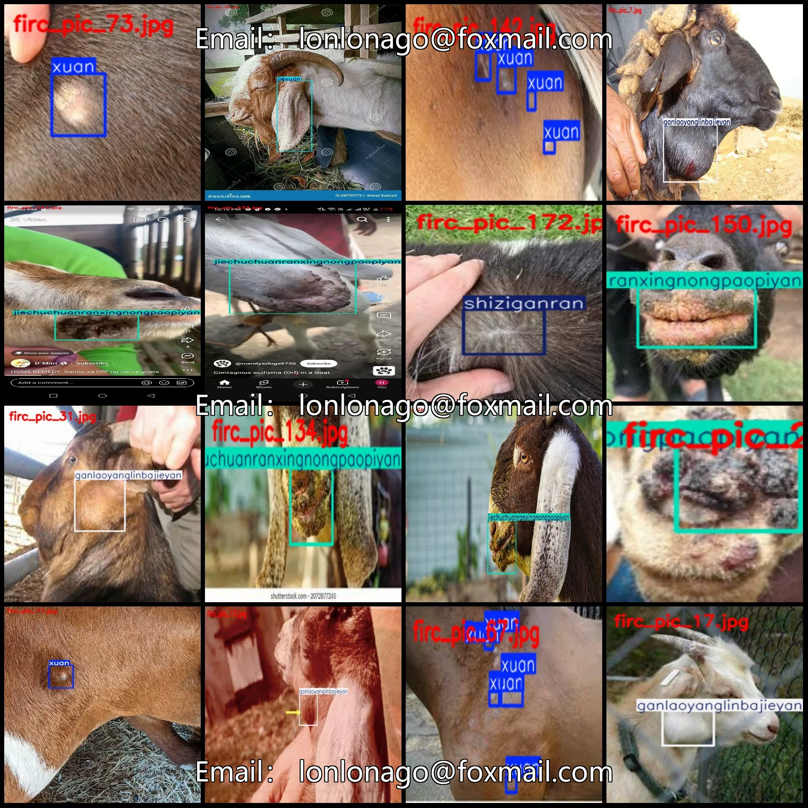
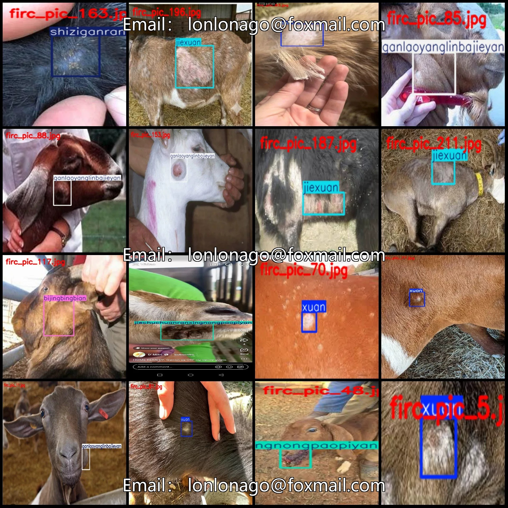
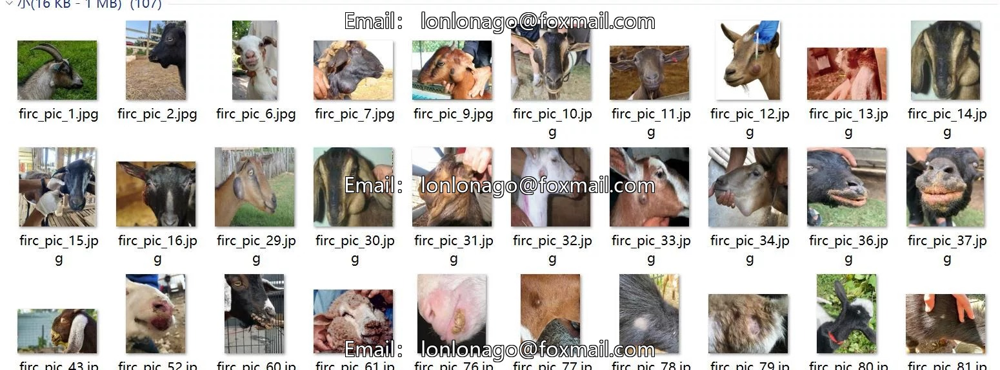
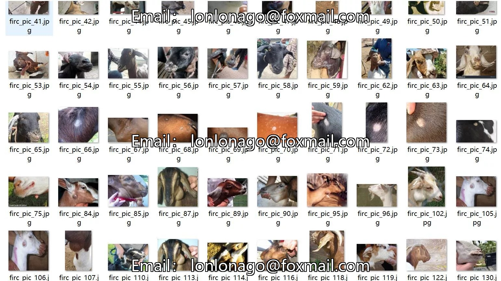
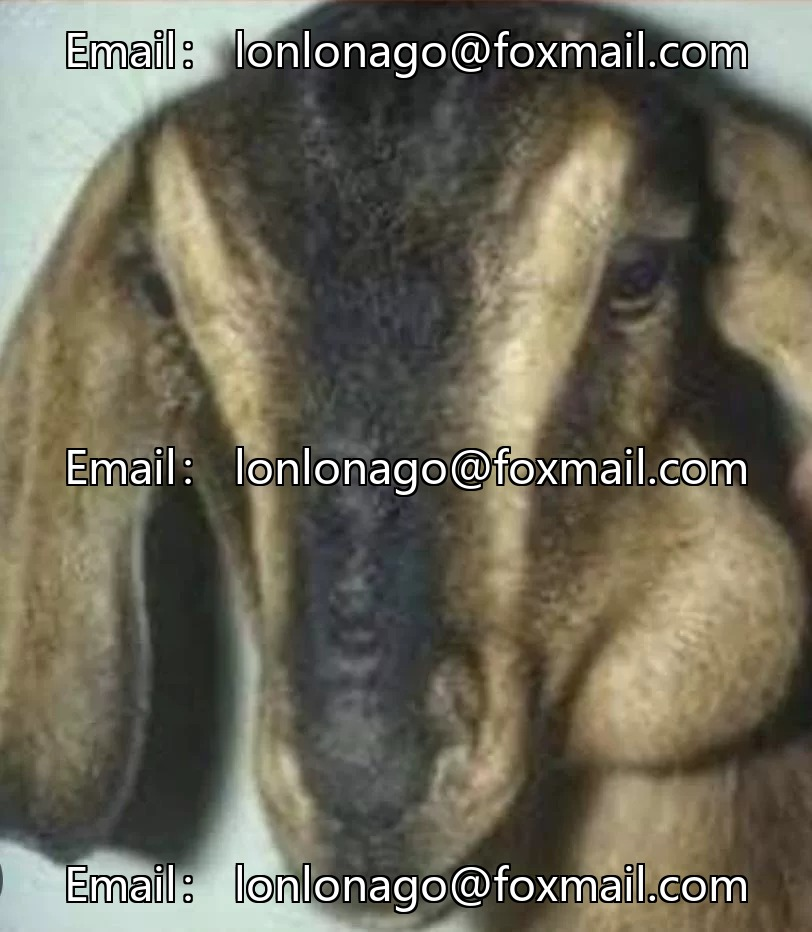
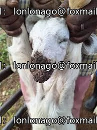

# Intelligent Dairy Goat Disease Detection Dataset VOC+YOLO format with 246 images in 7 categories

## Body

Smart Farming Sheep Disease Detection Dataset VOC+YOLO Format: 246 Images in 7 Categories
Warm Reminder: Due to the dataset's replicability, please confirm compliance with requirements before purchasing.
Dataset Format: Pascal VOC format + YOLO format (txt file without split path, only containing jpg images and corresponding VOC format xml files and yolo format txt files)
Number of Images (Total jpg files): 246
Number of Annotations (Total xml files): 246
Number of Annotations (Total txt files): 246
Number of Annotation Categories: 7

Label category names (Note that the order of categories in yolo format does not correspond to this, but is based on the "labels" folder's "classes.txt"): ["bijingbingbian", "ganlaoyanglinbajieyan", "jiechuchuanranxingnongpaopiyan", "jiexuan", "koujiaoyan", "shiziganran", "xuan

Number of boxes and the number of images occupied by each category
Bijingbingbian frame count = 5, occupy image count = 5
Ganlaoyanglinbajieyan frame count = 58, occupying image count = 57
jiechuchuanranxingnongpaopiyan frame count = 75, occupy image count = 75
Jiexuan box count = 50, occupying image count = 37
koujiaoyan box number = 10, occupying picture number = 10
shiziganran frame count = 35, occupying image count = 19
Frame count = 83, Image count = 43
Total frame count: 316

Image resolution: Multi-resolution images, such as 268x300, 259x194, etc.
Using labeling tool: labelImg
Labeling rules: Draw a rectangle around the category
Important note: The dataset does not have separate training, validation, and test sets; you need to partition them yourself.
Special declaration: This dataset does not guarantee the accuracy of the trained models or weight files.

## Images

## Payment

Here is a pay link on Stripe ( https://buy.stripe.com/3cs8yP7sY87d0vu9AB ). Please contact me lonlonago@foxmail.com after funding $89, and I will send you a complete data files , thank you!

